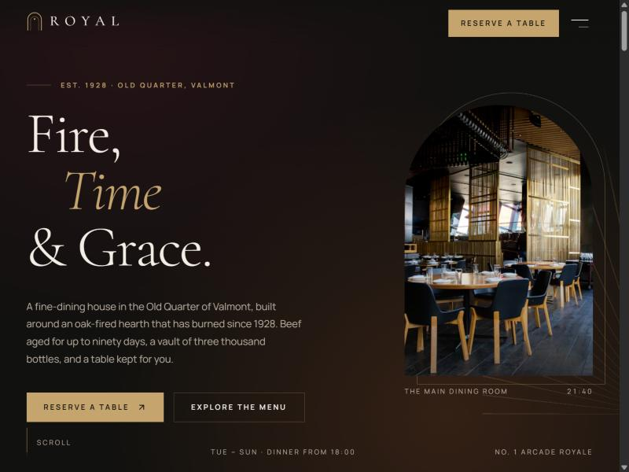
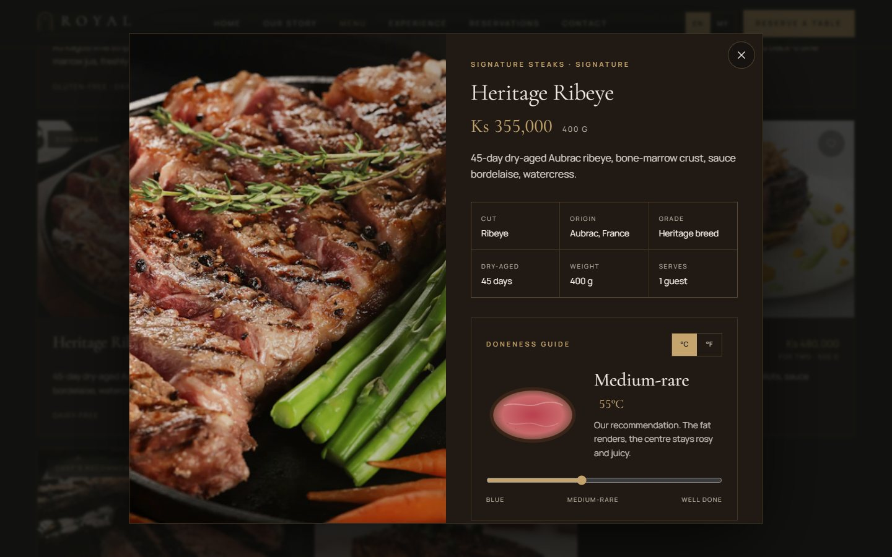
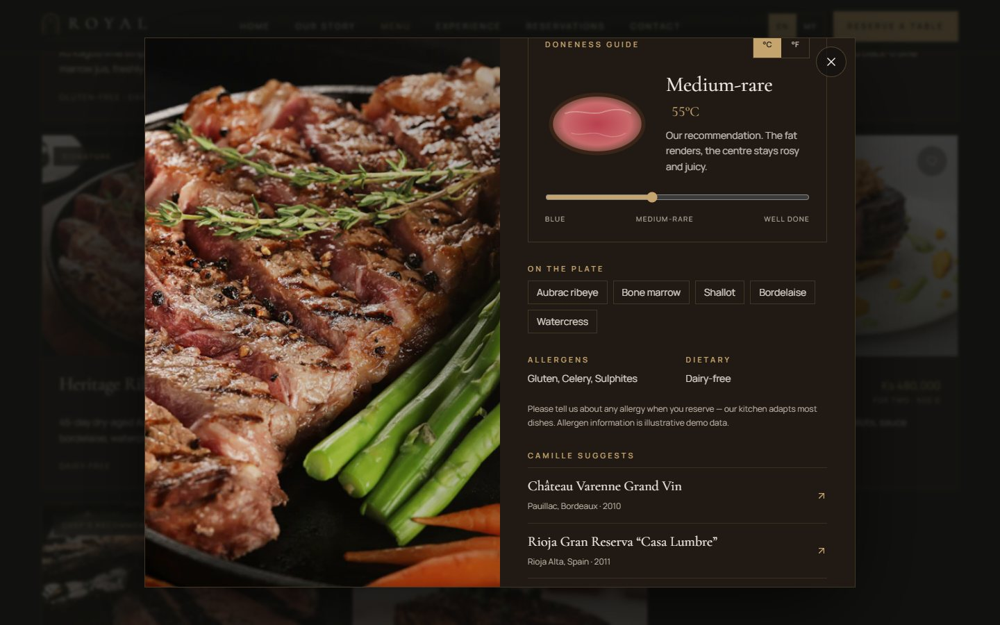
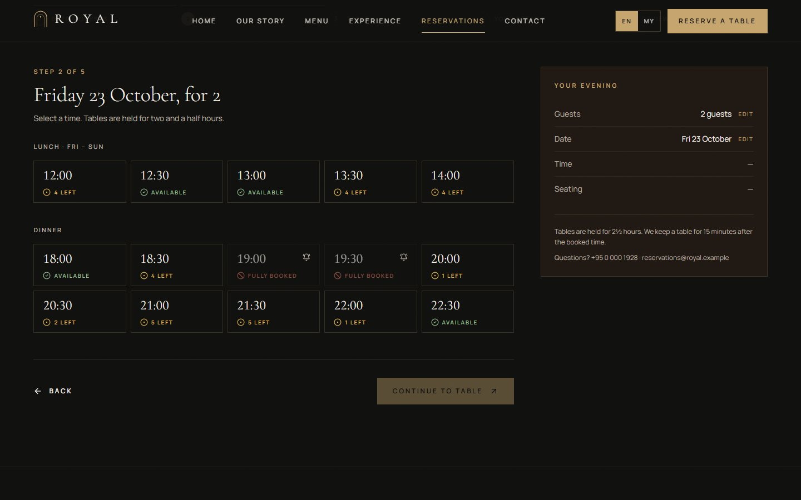
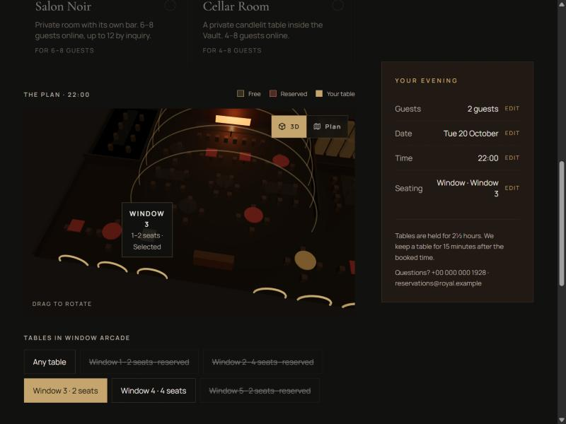
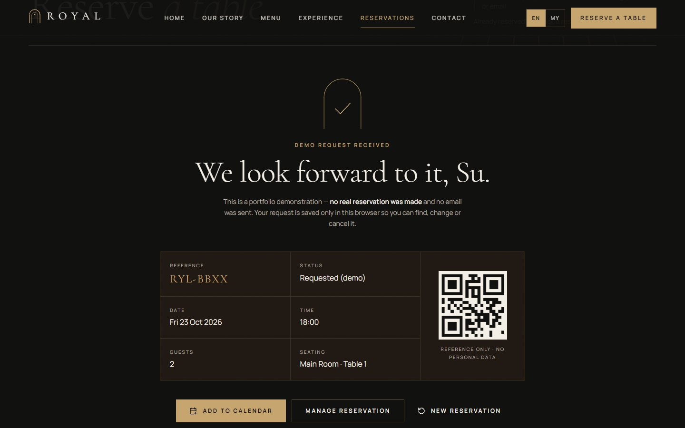
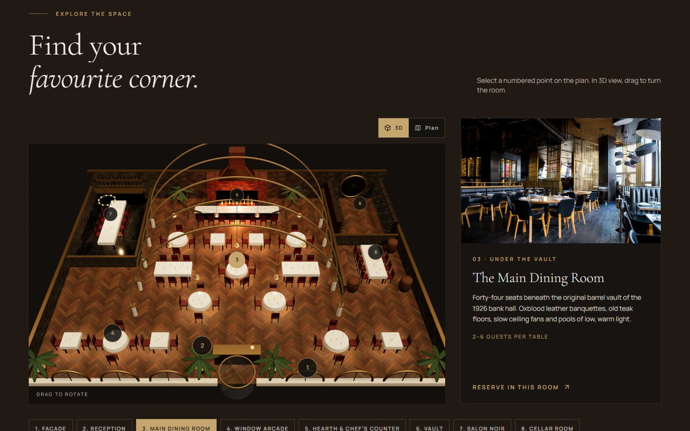
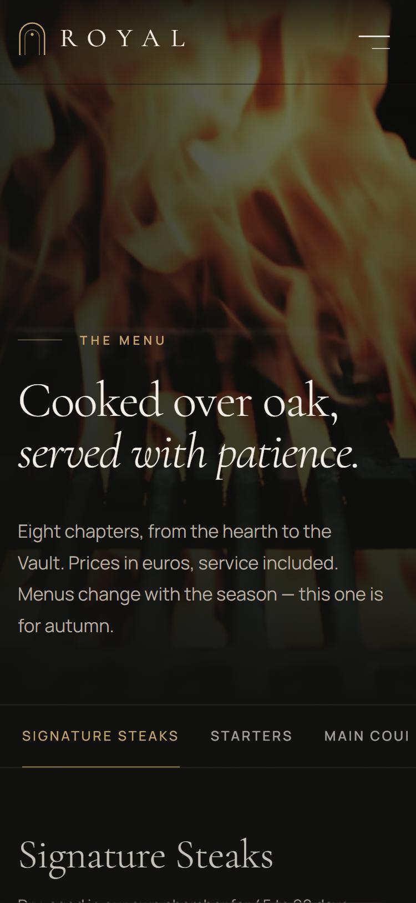

# ROYAL — Fire, Time & Grace

**A cinematic, interactive website for a fictional fine-dining restaurant and steakhouse.**
Frontend portfolio project: React, TypeScript, Framer Motion and a lazy-loaded React Three Fiber floor plan.

Designed & developed by **KoonSett (Win Thant Aung)** · [github.com/KoonKira](https://github.com/KoonKira)

> ROYAL is not a real restaurant. Its history, people, menu, prices, awards, reviews and availability are invented.
> No real reservation, payment or email ever happens. Reservations are stored only in your browser.



**Live demo:** _deploy with the steps below and add your URL here._

---

## The concept

ROYAL is a three-generation **international restaurant on the Hlaing riverfront in Kyimyindaing, Yangon, Myanmar**. It was founded in 1928 by
Henri Varenne, a cook from Lyon, and Daw Khin Mya. Today it sits in a 1926 bank hall with a barrel-vaulted ceiling,
built around a tamarind-wood hearth that has never gone out. The kitchen is French in technique and Burmese in
hospitality. The menu brings in Myeik Archipelago seafood, Shan highland produce, tea leaf, tamarind and jaggery,
and every price is in **Myanmar kyat (Ks)**. The site tells this story through **architecture** (arches, Burmese
teak, the vault), **fire** (live-fire steaks, dry ageing) and **hospitality** (the reservation experience).
The restaurant, its address and its phone number are fictional.

The design brief: contemporary European luxury, a modern steakhouse, editorial storytelling, architectural
minimalism and a touch of Art Deco. It should not read as a template.

## Design system

| | |
|---|---|
| **Palette** | Obsidian `#11110F` · Espresso `#211914` · Charcoal `#292724` · Royal Burgundy `#4A1825` · Champagne `#C5A46D` · Ivory `#F4EFE6` · Stone `#B8ADA0` |
| **Theming** | Semantic tokens (`bg`, `fg`, `muted`, `accent`, `line`) as CSS variables; `.theme-ivory` flips a section into a light editorial key with an accent deepened for AA contrast |
| **Type** | Cormorant Garamond for display (oversized, fluid `clamp()`), Manrope for UI and body, tabular figures for prices and times |
| **Signature shape** | The arch (`border-radius: 9999px 9999px 0 0`): hero frame, images, monogram, favicon, confirmation |
| **Texture** | Static SVG film grain and an Art Deco fan (`repeating-conic-gradient`) behind arches |
| **Motion** | One easing `cubic-bezier(0.22, 1, 0.36, 1)`, durations 0.25 / 0.6 / 1.1s, masked line reveals, clip-path image reveals |
| **Status** | Available / Limited / Fully booked are always shown with **icon and text**, never colour alone |

## Features

### Experience
- **First-visit intro**: the arch monogram draws itself (under 1.6s, skippable, once per session, off for reduced motion).
- **Cinematic hero**: three depth layers (Art Deco fan, outlined arch, photographed arch) move with the pointer and the scroll. Perspective without WebGL.
- **Scroll-linked manifesto**: words brighten as you read. Scroll is never hijacked.
- **Signature index**: hover or focus a dish to swap the sticky image (an accordion on mobile).
- **Route transitions**: an espresso curtain with a champagne edge, about 350ms each way.
- Magnetic CTAs and a contextual "View" cursor on desktop only, plus a lightbox gallery with keyboard and swipe support.

### Menu explorer `/menu`

- 8 categories and 60+ items: Signature Steaks, Starters, Main Courses, Seafood, Pasta, Desserts, Wine & Champagne, Cocktails & Beverages.
- The category is kept in the URL (`?c=wine`), and every dish has its own link (`/menu/heritage-ribeye`).
- Live search across all categories, dietary filters, Chef's picks, price sort, and an empty state.
- FLIP-animated filtering, plus 3D tilt cards on desktop.
- Wine is shown as a cellar-book list, not as cards.
- **Steak detail**: cut, origin, grade, ageing, plus an interactive **doneness guide** (cross-section, °C/°F, chef's note).
- **Wine detail**: producer, region, varietal, vintage and a **flavour profile**.
- **"My Evening"** wishlist, saved in the browser. It can be attached to a reservation as a note for the kitchen.



### Reservations `/reservations`


A 5-step flow (date & guests, time, table, details, review). It survives a page refresh.

- An accessible calendar (roving focus with arrows / Home / End / PageUp / PageDown) shows per-day availability **for the chosen party size**.
- Time slots show Available / "2 left" / Fully booked, with a demo "notify me" option on full slots.
- Choose a room and, optionally, **pick your exact table on the 3D floor plan**. A 2D SVG plan with real buttons is used on mobile, with reduced motion, and as the accessible path.
- React Hook Form + Zod validation, with focus moved to the first invalid field.
- The edge cases a real restaurant has to handle:
  - closed Mondays, lunch only Friday to Sunday
  - booking up to 60 days ahead, and closing 2 hours before the slot
  - 9+ guests sent to a private-dining inquiry
  - Chef's Counter at dinner only
  - fictional private-event days
  - a simulated "another guest took this slot" conflict that offers the nearest times
  - network-error retry and double-submit prevention
- **Confirmation**: a champagne burst, a reference such as `RYL-7F3K`, a QR code (reference only, no personal data) and an **.ics** calendar file.
- **Manage** `/reservations/manage`: find by reference + email, change the date, time or guests (availability is re-checked), or cancel with a confirmation dialog.




### Experience `/experience`
- An architectural walk-through of eight spaces, with material callouts.
- **Explore the Space**: numbered hotspots on the 3D or 2D plan open the story of each room.
- Six dining experiences, each with its own visual tone. Their buttons start a reservation with the room or occasion already filled in.
- The seven-course Chef's Tasting in a native scroll-snap strip, plus a filterable gallery with a lightbox.



### Also
- **Our Story**: a timeline whose thread draws as you scroll, the philosophy, sourcing, techniques, the chef and brigade, and fictional accolades.
- **Contact**: hours, a stylised map of the fictional quarter, and a validated private-dining inquiry form (demo).
- An elegant 404 ("This table doesn't exist… yet."), a photo-credits page, and per-route titles and descriptions.



## Architecture

```
UI (pages, components)
   │  uses
   ▼
ReservationService (interface)  ── src/services/reservationService.ts
   │  implemented by
   ▼
localReservationService ── localStorage + simulated latency/errors
   │  asks
   ▼
availability engine ── deterministic seeded "occupancy" per (date, time, table),
                       weighted by weekday, hour and lead time, plus the visitor's own bookings
```

- **Content is data**: menu, wines, spaces, experiences, story, team and tables live in typed files in `src/data`.
- **One seam for a backend**: swap the service in `src/services/index.ts`. See [docs/backend-integration.md](docs/backend-integration.md) and [supabase/schema.sql](supabase/schema.sql).
- **State**: Zustand for the booking draft (sessionStorage) and the wishlist (localStorage). Local component state everywhere else.

```
src/
  app/          router, layout, page transitions, per-route meta
  pages/        Home, Story, Menu, Experience, Reservations, ManageReservation, Contact, Credits, NotFound
  components/   ui/ layout/ home/ menu/ experience/ reservation/ gallery/ contact/
  three/        FloorPlan (chooser), FloorPlanScene (R3F, lazy), FloorPlan2D (accessible SVG)
  motion/       tokens and reveal components
  services/     reservation service, availability engine, rules, .ics, reference generator
  store/        reservation draft, wishlist, toast
  data/         menu, story, spaces, experiences, tables, site, image alt text
```

## Tech stack

React 18 · TypeScript (strict) · Vite 6 · Tailwind CSS 3 · React Router 6 · Framer Motion 11 ·
React Three Fiber + drei (three.js) · Zustand · React Hook Form + Zod · date-fns · lucide-react · qrcode

## Performance & accessibility

- Routes are code-split. **three.js (~226 kB gzip) is in its own chunk and only loads when the 3D view is shown.** The first page load ships ~120 kB of gzipped JS.
- Photos are served as WebP in two widths with `srcset`/`sizes`, lazy below the fold, with a preloaded hero.
- The 3D canvas stops rendering when off-screen, caps DPR at 1.75 and never captures the scroll wheel.
- `MotionConfig reducedMotion="user"` plus CSS: reduced motion turns off parallax, tilt, the intro, smooth scrolling and the 3D default.
- Semantic landmarks, a skip link, visible focus rings and focus-trapped dialogs that restore focus.
- Live regions announce availability and form status. Status uses icon + text. Touch targets are at least 44px.

## Run it

```bash
npm install
npm run dev
```

Other scripts: `npm run build` (type-check + production build), `npm run preview`, `npm run lint`,
`npm run build:pages` (GitHub Pages build under `/RoyalRestaurant/` with an SPA 404 fallback).

**Deploy:** Vercel works out of the box (`vercel.json` rewrites all routes to the SPA). For GitHub Pages, run
`npm run build:pages` and publish `dist/`. Change the `--base` in `package.json` if your repository name differs.

**Try the edge cases** (in the browser console, then reload):

```js
localStorage.setItem('royal.demo.conflictRate', '1') // every booking "loses" its slot → alternatives offered
localStorage.setItem('royal.demo.errorRate', '1')    // simulated network failure → retry
localStorage.removeItem('royal.demo.conflictRate'); localStorage.removeItem('royal.demo.errorRate')
```

## Checks performed

- `tsc -b`: no type errors · `eslint .`: clean · `vite build`: succeeds
- Manual browser pass (desktop 1024px and mobile 375px):
  - every route renders, with no horizontal overflow at 375px
  - menu filtering, deep-linked dish modal and Escape to close
  - full reservation (date → time → 3D table → validation errors → details → simulated conflict → success)
  - find → change party size → cancel
  - mobile menu focus trap and Escape
  - hash links to sections

## Known limitations

- No backend: reservations live in one browser, and availability is generated, not real.
- Photography is stock (Unsplash), so a few images are close to, but not exactly, what the copy describes.
- Lighthouse scores have not been recorded yet. Run it against a production deploy.
- Social links point to the platforms' home pages, because the brand has no real accounts.

## Credits

Photography from [Unsplash](https://unsplash.com) under the Unsplash License. See [CREDITS.md](CREDITS.md) or the in-site
`/credits` page. Fonts: Cormorant Garamond and Manrope (Google Fonts).
